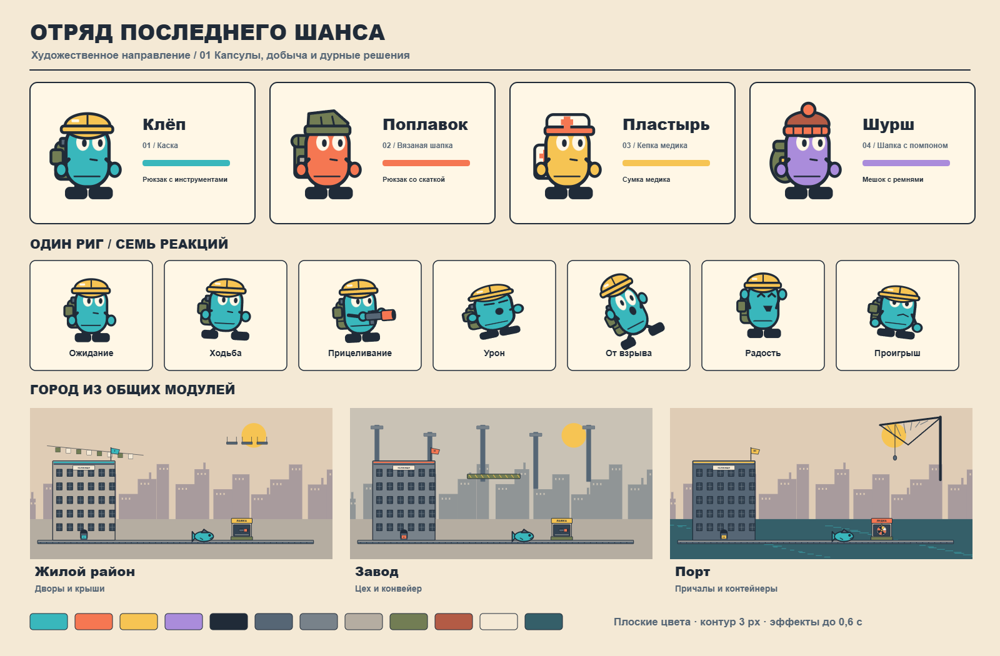

# Отряд последнего шанса — художественный комплект v0.1

Готова визуальная основа игры: четыре оригинальных персонажа-капсулы, семь общих анимаций, ограниченная плоская палитра, модульный промышленный город и проверочная арена с добычей, выстрелами и разрушениями.

**Откройте [preview/index.html](preview/index.html) в Edge или Chrome** либо запустите `Открыть сцену.cmd`. Установка и сервер для просмотра не нужны.



## Документы и ассеты

- [ART_DIRECTION.md](ART_DIRECTION.md) — закреплённые правила персонажей, анимации, окружения, эффектов и механик.
- [assets/manifest.json](assets/manifest.json) — точки крепления, порядок кадров и настройки ассетов.
- [docs/ASSET_PIPELINE.md](docs/ASSET_PIPELINE.md) — воспроизводимый экспорт и инструкция импорта в Unity.
- [docs/VERIFICATION.md](docs/VERIFICATION.md) — результаты тестов и замера, включая ограничения измерения.
- [PROJECT_PROGRESS.md](PROJECT_PROGRESS.md) — состояние этапа и дальнейшая работа.

Оригинальные PNG находятся в `assets/sprites/`, SVG-исходники — в `assets/source/`. Общая карта и три арены доступны в `assets/previews/`. Переданные пользователем материалы сохранены отдельно в `references/`. Готовый комплект для переноса: [LastChance-ArtKit-v0.1.zip](artifacts/LastChance-ArtKit-v0.1.zip).

## Проверочная сцена

Это локальная художественная сцена с управлением четырьмя бойцами по очереди. Она проверяет внешний вид и базовые физические ситуации.

| Управление | Действие |
| --- | --- |
| A / D | ходьба с расходом отдельной мобильности |
| Space | прыжок за 15 мобильности |
| Shift | рывок за 25 |
| Мышь / ЛКМ | прицеливание / выстрел, доступные и при нуле мобильности |
| E | ближайшая лавка, автомат, убежище или добыча |
| Enter | завершить ход и перейти к следующему бойцу |
| Escape | закрыть открытое окно |

Чтобы занять убежище, нажмите E внутри гаража или сторожки. Цвет, флаг и знак покажут владельца; в начале собственного хода внутри оно лечит на 8 HP. Возле лавки можно купить аптечку. Возле автомата — поставить 10/20/30 максимальной мобильности на улучшение или рискнуть переносимым трофеем. Результат виден в общей сцене. Потерянный максимум не восстанавливается обычной сменой хода.

Кнопка «Карта города» переключает жилой район, завод и порт. «Нагрузка» создаёт сцену с 48 физическими трофеями и непрерывными выстрелами/разрушениями. «Замерить 30 секунд» собирает отчёт, который можно скачать. Уменьшение эффектов и включение тряски регулируются отдельно; тряска изначально выключена.

Сцена не сохраняет прогресс; «Заново», смена района и выключение режима нагрузки создают новый пример. Нокаут и падение здесь упрощены для визуальной проверки. Череп рулетки показывает проигрыш; система проклятий ещё не реализована. Таймер продолжает идти в открытых окнах торговли и ставки.

## Проверки

14 тестов правил прошли; 224 кадра проверены на пустоты и обрезание; проверки интерфейса прошли в Microsoft Edge. За 30 секунд нагрузки при 1600 × 800 95-й процентиль времени JavaScript-расчёта и подачи Canvas-отрисовки составил 1,1 мс на кадр. Это результат браузерного прототипа; Unity Player, GPU-время готового кадра и сеть отдельно не измерены.

Для разработки:

```powershell
npm ci
npm test
npm run export
python tools/verify-assets.py
npm run verify
npm run preview
```

Последняя команда запускает локальный сервер на `http://127.0.0.1:4173/preview/index.html`; остановка — Ctrl+C.

Художественный этап завершён. Полная Unity-игра, онлайн-кооператив, сохранения, полная кампания и Windows EXE из приложенного большого ТЗ относятся к следующим этапам. В этом комплекте их готовность не заявляется.
